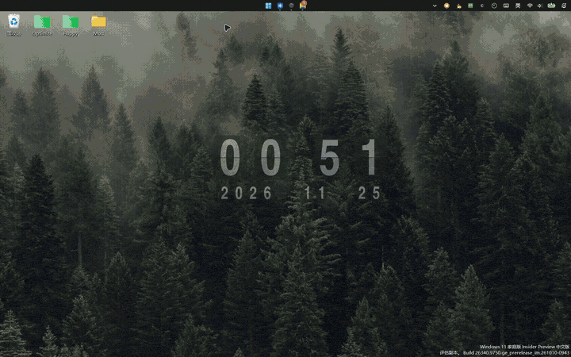

# Aleph Canvas

Aleph is a standalone Windhawk tool mod. It runs in Windhawk's dedicated tool
process and uses two topmost windows: a host for DWM thumbnails and input, and
a transparent layered HUD for card chrome, labels, status badges, guides, and
the minimap. No Explorer implementation details or private virtual-desktop
interfaces are used.

## Coordinate and window policy

Canvas coordinates are physical pixels relative to the virtual-screen origin.
This differs from the guide's 96-DPI world-coordinate proposal, but avoids
applying a monitor-specific scale to windows spanning monitors with different
DPI. UI chrome scales with the monitor under the pointer. The mod never moves
real windows while arranging cards; dragging a canvas card only changes the
saved canvas layout.

Activating an other-desktop card asks the public virtual desktop manager's
`MoveWindowToDesktop` for the desktop that `GetWindowDesktopId` reports for the
canvas host window, which is the desktop showing the canvas the user just
clicked. A window that already sits there is never moved. Windows can reject
requests for windows owned by another process. The mod logs a refused move
and still attempts normal foreground activation, which can also fail.

Duplicate windows keep their assigned executable/class slots while alive.
Icon cards draw the largest icon the shell offers - the 256 px jumbo image list
when available, then the 48 px and 32 px lists, and the window icon only when
no shell icon resolves.
After a restart, indistinguishable windows reuse available saved slots; the
mod cannot identify which document belongs to which identical window class.
Visible idle canvases rescan windows at the configured interval; they do not
redraw continuously. The canvas also hides when another window takes input
focus. Hidden canvases wait for events and pending layout saves.

## Controls

- `Ctrl+Alt+Shift+F12`: toggle the canvas by default. Leave the hotkey setting
  empty to disable it.
- Mouse wheel: zoom around the pointer.
- Middle mouse drag: pan the canvas.
- Hold Space and drag empty canvas: pan.
- Drag a card: arrange it; nearby edges snap into alignment.
- Double-click a card or press Enter: focus the window; for an other-desktop
  window, first try to move it here.
- Tab / Shift+Tab: select a card; arrow keys pan; Home fits all cards;
  Escape hides the canvas.
- Click or drag the minimap: navigate the canvas.
- The canvas hides when another window takes input focus.

## Interface language

Card badges and the empty-canvas hint are localized in thirteen languages.
The `Interface language` setting under `Behavior` defaults to `Auto`, which
follows the Windows UI language and falls back to English when that language is
not supported. An explicit choice overrides the system language, and an
unrecognized stored value also falls back to English.

## Card controls

Every card reserves a 44 DIP header above the window preview. The header shows
the window title and up to three buttons on the right edge; a card that is too
narrow for the row drops the group button first and then the whole row. The
buttons are sized relative to the header (30 DIP squares) rather than to an
absolute pixel count, so pin, group and close stay legible on large cards
instead of shrinking into a corner.

- Pin raises the card above every unpinned card and is saved with the layout,
  so a pinned card returns pinned after a restart.
- Group appears once another window of the same executable is on the canvas,
  and on any card that belongs to a stack of its own. It joins those windows
  into one stack, and pressing it again splits the stack into a row starting
  where the stack stood. The grouped state is saved with the layout, so a
  rescan or a restart keeps the group together or apart.
- Alt+dragging one card onto another makes a stack of its own, even when the
  two windows belong to different applications. A drop only counts when the
  cards overlap solidly, so dragging a card across another one never glues them
  together by accident. Dropping onto a member of an existing stack brings that
  whole stack along instead of forming a second one. The stack keeps its own
  key in the saved layout, so the same windows come back stacked together after
  a restart.
- Alt+dragging a member out of a stack releases just that window: it takes back
  its own window size, settles its centre where the pointer let go, and stays
  out of the automatic per-application group until the user stacks it again.
- While Alt is held, the card under the pointer is outlined as the drop target,
  so the join is visible before the button is released.
- A plain drop never groups anything. Releasing a dragged card only leaves it
  where it was dropped; the desktop Z-order decides which window covers which.
- A stack is one shared rectangle, not a pile of differently sized windows. The
  frame is taken from the front card when the stack forms and then stays put, so
  every member is fanned inside the same size and centre even when its own
  window is far wider or taller; cycling the stack with the wheel therefore
  feels like rotating one card instead of jumping between shapes. Members whose
  window aspect differs from the frame get a letterboxed preview, so a window is
  never stretched or cropped by the shared frame.
- The `Stack rotation direction` setting chooses which way the fan turns away
  from the front card: `Counter-clockwise` (the default), `Clockwise`, or `No
  rotation` for a straight stack behind the front card.
- Close posts `WM_CLOSE` to the card's real window, so the application closes
  as it would from its own title bar. The card leaves the canvas once the next
  scan reports the window gone; a window that refuses to close, such as one
  showing a save prompt, keeps its card.
- Hovering a button draws a localized tooltip above it. The HUD is a layered
  click-through window, so the tooltip is drawn by the HUD instead of by a
  native Win32 tooltip control.
- Dragging the header's title area still moves the card, and double-clicking
  the header still dives into the window; the buttons themselves only perform
  their own action.

## Manual verification

1. Enable the mod, toggle the canvas, and check that live windows show DWM
   previews while minimized and other-desktop windows show icon cards.
2. Pan with the middle button or Space+drag; zoom with the wheel and verify the
   point under the pointer stays fixed.
3. Drag cards, verify edge and center snapping, then restart the tool process
   and confirm saved positions return.
4. Navigate via the minimap, select with Tab, pan with arrows, fit with Home,
   and activate with Enter or double-click.
5. Open a window on another virtual desktop, double-click its icon card, and
   check that the window is restored and focused when Windows permits the
   move. If Windows refuses, check the Windhawk log and confirm the canvas
   continues to work.
6. Pin two cards and confirm both stay above the rest, restart the tool process
   and confirm they are still pinned. Hover each header button and confirm the
   tooltip names it, then close one card and confirm the real window closes
   rather than the card merely disappearing until the canvas is shown again.
   Open two windows of one application, split the automatic group with the
   group button, and confirm the windows fan out and are still apart after a
   restart.
7. Stack two windows of very different sizes, hold Alt and roll the wheel, and
   confirm the stack rotates as one card of constant size instead of the larger
   window covering the smaller one; confirm the smaller window's preview keeps
   its own aspect inside the shared frame.
8. Hold Alt, drag a window onto a window of another application, and confirm
   the target card is outlined and the two fan into one stack that survives a
   restart; then hold Alt, drag one member out, and confirm it keeps its own
   size and lands where it was dropped. Drop a card with Alt released and
   confirm nothing is grouped.
9. Check mixed-DPI displays, a window spanning monitors, 15 or more windows,
   and repeated enable/disable cycles. Confirm Explorer desktop positions stay
   unchanged throughout.

These runtime checks require a Windows session and are not covered by the
repository's bundler unit tests.
